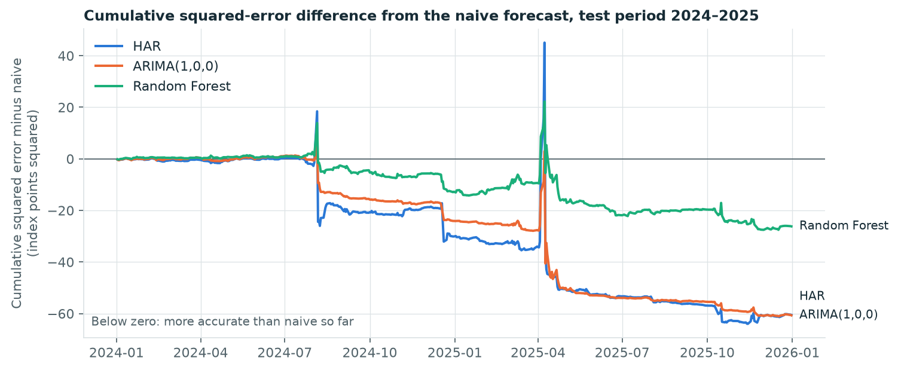

# One-day-ahead VIX forecasting

Does a more complex model predict tomorrow's VIX close better than simply carrying today's close forward? This independent research project compares a naive forecast, ARIMA, a HAR regression and a Random Forest on daily VIX closes from 2015 to 2025, using only the history of the index.

## Result

On the 2024–2025 test period (502 sessions), **no fitted model is statistically distinguishable from the naive forecast**, and Random Forest does not improve on the simpler linear models.

| Forecast | RMSE | MAE | RMSE relative to naive | MAE relative to naive |
|---|---|---|---|---|
| Naive (today's close) | 2.0656 | 1.0975 | 1.000 | 1.000 |
| HAR regression | 2.0362 | 1.0983 | 0.986 | 1.001 |
| ARIMA(1,0,0) | 2.0361 | 1.0910 | 0.986 | 0.994 |
| Random Forest | 2.0529 | 1.0929 | 0.994 | 0.996 |

Errors are in VIX index points.

- **Small margins.** The fitted models lower RMSE by 0.6% to 1.4%. None of ten Diebold–Mariano tests rejects equal accuracy at the 5% level; the smallest p-value is 0.066.
- **Simple models did at least as well.** An autoregression of order one and the three-term HAR regression were at least as accurate as a 500-tree Random Forest.
- **A few days decide everything.** The 26 largest-move days (5% of the period) produce about three quarters of every forecast's squared error, and no model anticipates them.



The figure accumulates each model's squared error minus the naive forecast's; below zero means more accurate than naive so far. The fitted models gain only around three episodes of sharp movement, on the days the VIX fell back after a spike.

**Checked over nine years.** An exploratory re-run of the same models over 2017–2025, added after the test, supports the result: the RMSE advantage over naive shrinks to 0.3%–0.5% and is not significant, and the models beat naive in only 6 or 7 of 9 years. A Clark–West test does find mean reversion in the VIX, so the signal exists but is too weak to yield a reliably better forecast. The one exception is that the HAR regression has a small (2%) but statistically significant advantage in MAE.

The full analysis, including limitations, is in the [research report](report/report_draft.md).

## How the comparison was run

- **Data.** 2,766 daily closes from Cboe, 2015-01-02 to 2025-12-31, reconciled to a frozen NYSE regular-session calendar. Of 2,793 source rows, 27 non-session dates were excluded and logged; no value was imputed or altered.
- **Split.** Training 2015–2021, validation 2022–2023, test 2024–2025, in chronological order.
- **Protocol fixed first.** The models, candidate settings, selection rule and statistical tests were [written down](report/report_draft.md#4-methodology-and-evaluation-protocol) before any model was fitted.
- **Selection on validation only.** 18 ARIMA and 24 Random Forest candidates were compared on 2022–2023; the notebook that does this never loads the test years.
- **One test run.** The selected configurations were evaluated once on 2024–2025.
- **Walk-forward forecasts.** Models are re-estimated monthly on all data available at that point, and every forecast uses only closes dated before its target. Automated tests check this.

The commit history records these steps in order: protocol, then selection, then test results.

## Contents

| Path | What it holds |
|---|---|
| [`report/report_draft.md`](report/report_draft.md) | Research report: motivation, data, exploratory analysis, protocol, selection and results |
| [`notebooks/01_exploratory_analysis.ipynb`](notebooks/01_exploratory_analysis.ipynb) | Levels, daily changes, stationarity and autocorrelation in the training period |
| [`notebooks/02_model_selection.ipynb`](notebooks/02_model_selection.ipynb) | Validation-period comparison of all candidates |
| [`notebooks/03_test_evaluation.ipynb`](notebooks/03_test_evaluation.ipynb) | Test-period accuracy, significance tests and error concentration |
| [`notebooks/04_robustness_checks.ipynb`](notebooks/04_robustness_checks.ipynb) | Exploratory checks added after the test: residual diagnostics, nine-year comparison, Clark–West test |
| [`vixforecast/`](vixforecast) | Features, the four forecasting models and the walk-forward loop |
| [`tests/`](tests) | Checks on information timing and model behaviour |
| [`results/`](results) | Selected configurations and result tables |
| [`data/`](data) | [Data documentation](data/README.md), session calendar, exclusion log and [audit](data/data_audit.json) |
| [`presentation/speaker_notes.md`](presentation/speaker_notes.md) | Notes for the opening presentation |

## Reproduce

### 1. Prepare the data

In PowerShell, from the project root:

```powershell
./scripts/prepare_data.ps1 -Download
```

This downloads the official CSV, preserves it locally, extracts the requested date range, filters to the checked-in calendar and writes audit files. Routine preparation needs no additional packages. Regenerating the calendar uses Python and `requirements-data.txt`; instructions are in the data documentation. Raw and processed CSVs are excluded from Git; the calendar, exclusion log and audit metadata are included.

### 2. Set up Python and run the tests

```powershell
python -m venv .venv
./.venv/Scripts/python.exe -m pip install -r requirements-analysis.txt
./.venv/Scripts/python.exe -m pytest
```

The tests use a synthetic series and need no data files.

### 3. Run the notebooks in order

```powershell
./.venv/Scripts/python.exe -m jupyter nbconvert --to notebook --execute --inplace notebooks/01_exploratory_analysis.ipynb
./.venv/Scripts/python.exe -m jupyter nbconvert --to notebook --execute --inplace notebooks/02_model_selection.ipynb
./.venv/Scripts/python.exe -m jupyter nbconvert --to notebook --execute --inplace notebooks/03_test_evaluation.ipynb
./.venv/Scripts/python.exe -m jupyter nbconvert --to notebook --execute --inplace notebooks/04_robustness_checks.ipynb
```

The second notebook takes roughly 20 minutes; the others take a few minutes each. They rewrite the figures in `report/figures/` and the tables in `results/`. Random Forest uses a fixed seed, so the results are repeatable with the pinned package versions.

## Limitations

The result comes from a single two-year test window and uses only the history of the VIX. It covers one-session forecasts of the level and says nothing about longer horizons, large moves or trading value. A Cboe source file downloaded later may differ from the snapshot recorded in the data audit.

## Licence

Original code and documentation are released under the [MIT License](LICENSE). Cboe data is not redistributed here and remains subject to Cboe's terms.
