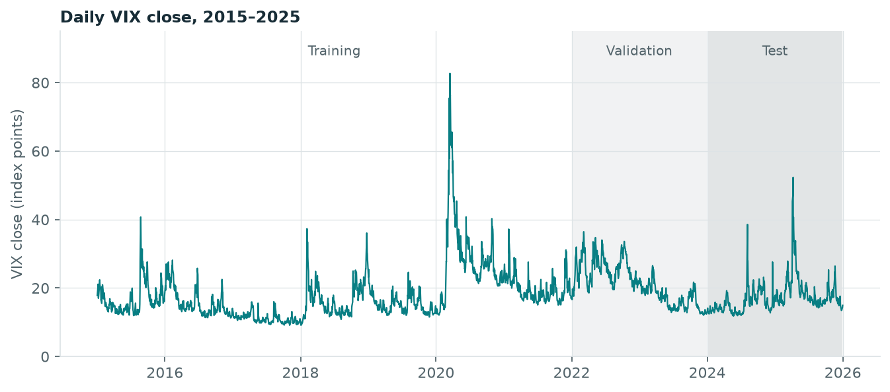
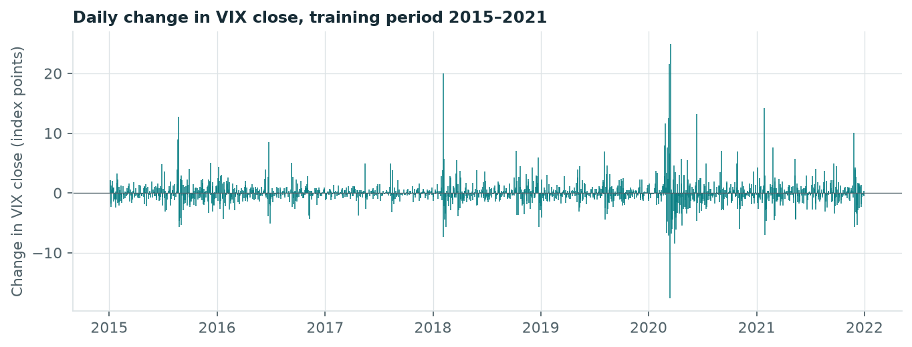
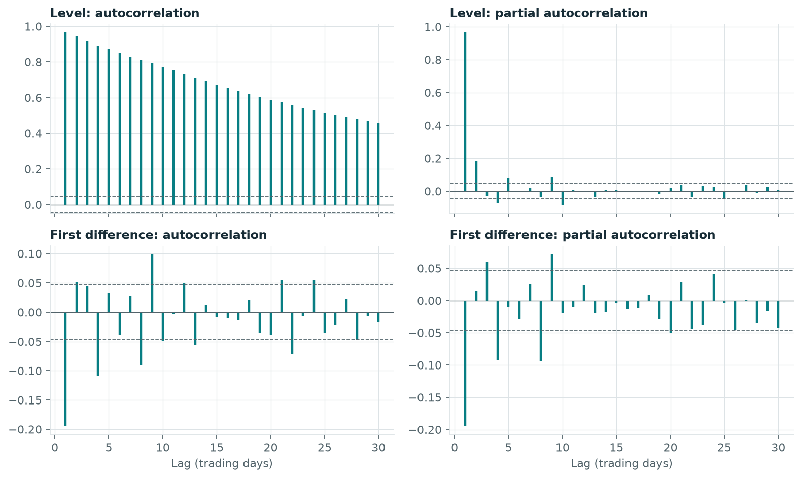

# One-Day-Ahead VIX Forecasting
## Comparing ARIMA, Random Forest and a Naive Benchmark

Independent research project

**Working research draft — updated 13 October 2026.** This document contains the research motivation, completed data preparation, exploratory analysis of the training period and proposed methodology. No models have been fitted and no forecast results are available.

## 1. Introduction

The Cboe Volatility Index (VIX) measures option-implied expectations of S&P 500 volatility over the next 30 calendar days, expressed on an annualised basis [1]. It is derived from option prices and is distinct from realised volatility calculated from observed market returns. This study concerns the next trading day's VIX closing level. Its one-day forecasting horizon is therefore different from the 30-day volatility horizon represented by the index.

The research investigates whether modelling historical VIX observations improves forecasts relative to carrying forward the most recent closing value. ARIMA and Random Forest provide two different approaches to extracting information from the same historical series. ARIMA models linear temporal relationships, while Random Forest can learn nonlinear relationships among features constructed from past observations. More complex modelling does not guarantee better out-of-sample predictions; the naive benchmark makes this a directly testable question.

The main research question is: **Does Random Forest improve one-trading-day-ahead VIX forecasting accuracy relative to ARIMA and a naive benchmark when predictions use only historical VIX observations?** A secondary descriptive question is whether differences in forecast errors are widespread or concentrated around a small number of large VIX movements.

The intended contribution is a transparent forecasting comparison with chronological evaluation and a common information set. The study will not interpret success on this sample as evidence of universal model superiority or trading profitability.

## 2. Index and proposed sample

The Cboe source has been downloaded and reconciled to a frozen NYSE regular-session calendar (XNYS, exchange_calendars 4.13.2). The modelling sample has 2,766 observations from 2 January 2015 to 31 December 2025. The original date-range extract has 2,793 observations; 27 non-session dates were excluded and logged. All expected regular-session dates are present, including early closes. No values were imputed or modified. Forecasts target the next regular-session date and are issued only after the preceding Cboe closing value is available. Source details, reproduction instructions and validation results are recorded in the [data documentation](../data/README.md).

The target is the VIX index itself, rather than a VIX futures contract or an exchange-traded product. Weekends and non-session holidays are not extra forecasting steps. The preparation script checks for missing expected sessions and stops rather than filling them automatically.

The sample spans eleven calendar years and predates the project. Its inclusion of the COVID-19 period provides a reason to investigate unusual observations and changing forecasting conditions; it does not establish robustness across all market conditions. Structural data checks and exploratory analysis of the training period are complete; model diagnostics remain to be conducted.

The provisional chronological split is:

| Role | Period | Purpose |
|---|---|---|
| Training | 2015–2021 | Estimate candidate models |
| Validation | 2022–2023 | Select model orders, features and hyperparameters |
| Test | 2024–2025 | Evaluate the selected procedures |

The boundaries will be fixed before comparing performance. A single split offers a manageable experiment but cannot establish performance stability across every possible evaluation window.

## 3. Exploratory analysis of the training period

The full series is shown once for context. Every statistic and diagnostic in this section uses only the 1,763 training observations (2 January 2015 to 31 December 2021), so that no modelling choice depends on validation or test data. The code and complete output are in the [exploratory notebook](../notebooks/01_exploratory_analysis.ipynb).

### Closing levels

| Statistic | VIX close (index points) |
|---|---|
| Mean | 17.80 |
| Median | 15.78 |
| Standard deviation | 7.81 |
| Minimum | 9.14 (3 November 2017) |
| Maximum | 82.69 (16 March 2020) |
| Skewness | 2.97 |

The level is usually low and occasionally very high: 44% of training days close below 15 and 5.4% close above 30. Taking logarithms reduces the skewness to 0.97 without removing it. The forecast target remains the level in index points; a logarithmic transformation is noted as an option and is not adopted.

### Day-to-day changes

The change y_t − y_(t−1) is the error a naive forecast would make on day t, so the size of daily changes sets the scale that any fitted model must improve on.

The mean change is approximately zero. The median absolute change is 0.70 points and 63% of days move by less than one point, while 44 days (2.5%) move by more than five. The changes are right-skewed (2.72) and heavy-tailed (excess kurtosis 32.9); nine of the ten largest moves are increases. Squared changes are highly concentrated: the 18 largest days (1% of the sample) account for 44% of the total, and the largest 5% for 68%.

The training-period mean absolute change is 1.16 points and the root mean squared change is 2.05 points. These describe the scale of the problem within the training data; they are not out-of-sample results. The concentration implies that RMSE will be driven by a small number of days while MAE reflects ordinary days, which motivates reporting both and examining how errors are distributed over time.

### Stationarity

| Series | ADF statistic | ADF p-value | KPSS statistic | KPSS p-value |
|---|---|---|---|---|
| Level | −4.53 | < 0.001 | 1.45 | ≤ 0.01 |
| First difference | −14.65 | < 0.001 | 0.01 | ≥ 0.10 |

Both tests include a constant and no trend. The ADF null hypothesis is a unit root; the KPSS null hypothesis is stationarity. For the level the two tests disagree: ADF rejects a unit root, consistent with reversion towards a typical range, while KPSS rejects stationarity, consistent with an average level that differs between calm and turbulent periods. This combination is common for a highly persistent series and does not determine the differencing order. The first difference is stationary under both tests.

### Autocorrelation

The level has autocorrelation 0.97 at lag 1, decaying slowly to 0.77 at lag 10 and 0.46 at lag 30. Its partial autocorrelation is concentrated in lag 1 (0.97) and lag 2 (0.18) and is below 0.1 in absolute value thereafter. The first difference has autocorrelation −0.20 at lag 1, so a rise tends to be partly reversed the next day; a Ljung–Box test rejects the absence of autocorrelation at 5, 10 and 20 lags. Absolute changes are positively autocorrelated (0.46 at lag 1), meaning that large moves cluster in time.

The dashed bands and the Ljung–Box p-values assume independent observations with constant variance. Given the heavy tails and clustering documented above, they overstate significance, and small autocorrelations at higher lags are not interpreted.

### Implications for modelling

- The most recent close carries most of the available information, so the naive forecast is a demanding benchmark and any improvement is likely to be small.
- Training-period diagnostics rule out neither d = 0 nor d = 1; both remain ARIMA candidates.
- Low autoregressive and moving-average orders are sufficient for the candidate set.
- Because large moves cluster, features summarising recent variability are worth testing for Random Forest. Its predictions are bounded by the training range of 9.14 to 82.69.

## 4. Proposed methodology

### Forecast target and information timing

Let y_t be the VIX closing level on trading day t. Each prediction targets y_(t+1) and is issued after y_t is available. Features must use only information observed through t. Earlier test observations may enter later forecasts as time advances; test errors must not guide model selection.

### Naive benchmark

The naive forecast is y-hat_(t+1|t) = y_t. It has no fitted parameters and establishes whether the other models improve on carrying today's closing value forward.

### ARIMA

ARIMA(p,d,q) combines autoregressive terms, differencing and moving-average terms based on past innovations. Training-period diagnostics (Section 3) do not determine the differencing order, so d = 0 and d = 1 both remain candidates. A small candidate set of low orders and chronological validation will keep selection manageable. Orders have not yet been selected and residual diagnostics have not yet been run.

### Random Forest

Random Forest averages predictions from an ensemble of regression trees. Historical observations must first be converted into supervised-learning examples, pairing features available at t with the next trading day's closing level. Candidate inputs include recent VIX levels and trailing summaries. Exact features and a small hyperparameter search will be defined before test evaluation. Trees do not automatically represent temporal order, and leaf-average predictions may struggle with outcomes beyond the range represented in training data.

### Evaluation

MAE and RMSE will be calculated on the same target dates in VIX index points. For errors e_i = y_i − y-hat_i and n forecasts:

- MAE = (1/n) × sum(|e_i|).
- RMSE = sqrt((1/n) × sum(e_i²)).

RMSE gives greater influence to large errors. If the metrics rank models differently, that difference will be discussed rather than hidden. After selection, fitted models can be re-estimated using data through the end of 2023. Parameter-refitting frequency and the treatment of model-state updates remain to be specified before testing. Neither lower average error nor a visual difference alone establishes statistical significance.

## 5. Remaining report sections

The literature review will be developed from verified forecasting and VIX research. Model diagnostics, empirical results, discussion, conclusion and abstract will be written after the relevant work is completed. No performance claims are available at this stage.

## References

[1] Cboe Global Markets. *Volatility Index Methodology: Cboe Volatility Index.* https://cdn.cboe.com/api/global/us_indices/governance/VIX_Methodology.pdf (consulted 8 October 2026).

## Progress log

- 8 October: research question, opening text, sample proposal and model comparison drafted.
- 13 October: downloaded the source data, validated values and reconciled the sample to regular US equity sessions.
- 13 October: completed exploratory analysis of the training period (levels, daily changes, stationarity tests, autocorrelation).
- Pending: verification of methodological literature, finalisation of the evaluation protocol, and model fitting.
