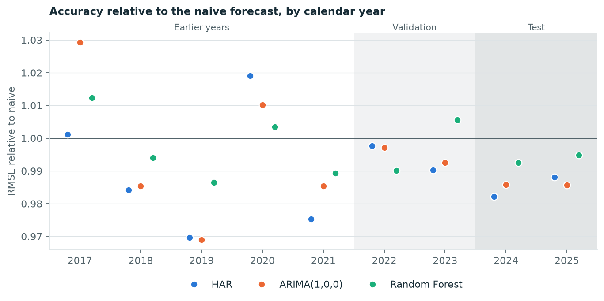

# One-Day-Ahead VIX Forecasting
## Comparing ARIMA, Random Forest and a Naive Benchmark

Independent research project

**Working research draft — updated 13 October 2026.** This document contains the research motivation, completed data preparation, exploratory analysis of the training period, the fixed evaluation protocol, model selection on the validation period, the test-period results and exploratory robustness checks. The literature review and abstract remain to be written.

## 1. Introduction

The Cboe Volatility Index (VIX) measures option-implied expectations of S&P 500 volatility over the next 30 calendar days, expressed on an annualised basis [1]. It is derived from option prices and is distinct from realised volatility calculated from observed market returns. This study concerns the next trading day's VIX closing level. Its one-day forecasting horizon is therefore different from the 30-day volatility horizon represented by the index.

The research investigates whether modelling historical VIX observations improves forecasts relative to carrying forward the most recent closing value. ARIMA and Random Forest provide two different approaches to extracting information from the same historical series. ARIMA models linear temporal relationships, while Random Forest can learn nonlinear relationships among features constructed from past observations. More complex modelling does not guarantee better out-of-sample predictions; the naive benchmark makes this a directly testable question.

The main research question is: **Does Random Forest improve one-trading-day-ahead VIX forecasting accuracy relative to ARIMA and a naive benchmark when predictions use only historical VIX observations?** A secondary descriptive question is whether differences in forecast errors are widespread or concentrated around a small number of large VIX movements.

The intended contribution is a transparent forecasting comparison with chronological evaluation and a common information set. The study will not interpret success on this sample as evidence of universal model superiority or trading profitability.

## 2. Index and proposed sample

The Cboe source has been downloaded and reconciled to a frozen NYSE regular-session calendar (XNYS, exchange_calendars 4.13.2). The modelling sample has 2,766 observations from 2 January 2015 to 31 December 2025. The original date-range extract has 2,793 observations; 27 non-session dates were excluded and logged. All expected regular-session dates are present, including early closes. No values were imputed or modified. Forecasts target the next regular-session date and are issued only after the preceding Cboe closing value is available. Source details, reproduction instructions and validation results are recorded in the [data documentation](../data/README.md).

The target is the VIX index itself, rather than a VIX futures contract or an exchange-traded product. Weekends and non-session holidays are not extra forecasting steps. The preparation script checks for missing expected sessions and stops rather than filling them automatically.

The sample spans eleven calendar years and predates the project. Its inclusion of the COVID-19 period provides a reason to investigate unusual observations and changing forecasting conditions; it does not establish robustness across all market conditions. Structural data checks and exploratory analysis of the training period are complete; model diagnostics remain to be conducted.

The chronological split, fixed before any model was fitted, is:

| Role | Period | Purpose |
|---|---|---|
| Training | 2015–2021 | Estimate candidate models |
| Validation | 2022–2023 | Select model orders, features and hyperparameters |
| Test | 2024–2025 | Evaluate the selected procedures |

A single split offers a manageable experiment but cannot establish performance stability across every possible evaluation window.

## 3. Exploratory analysis of the training period

The full series is shown once for context. Every statistic and diagnostic in this section uses only the 1,763 training observations (2 January 2015 to 31 December 2021), so that no modelling choice depends on validation or test data. The code and complete output are in the [exploratory notebook](../notebooks/01_exploratory_analysis.ipynb).

### Closing levels

| Statistic | VIX close (index points) |
|---|---|
| Mean | 17.80 |
| Median | 15.78 |
| Standard deviation | 7.81 |
| Minimum | 9.14 (3 November 2017) |
| Maximum | 82.69 (16 March 2020) |
| Skewness | 2.97 |

The level is usually low and occasionally very high: 44% of training days close below 15 and 5.4% close above 30. Taking logarithms reduces the skewness to 0.97 without removing it. The forecast target remains the level in index points; a logarithmic transformation is noted as an option and is not adopted.

### Day-to-day changes

The change y_t − y_(t−1) is the error a naive forecast would make on day t, so the size of daily changes sets the scale that any fitted model must improve on.

The mean change is approximately zero. The median absolute change is 0.70 points and 63% of days move by less than one point, while 44 days (2.5%) move by more than five. The changes are right-skewed (2.72) and heavy-tailed (excess kurtosis 32.9); nine of the ten largest moves are increases. Squared changes are highly concentrated: the 18 largest days (1% of the sample) account for 44% of the total, and the largest 5% for 68%.

The training-period mean absolute change is 1.16 points and the root mean squared change is 2.05 points. These describe the scale of the problem within the training data; they are not out-of-sample results. The concentration implies that RMSE will be driven by a small number of days while MAE reflects ordinary days, which motivates reporting both and examining how errors are distributed over time.

### Stationarity

| Series | ADF statistic | ADF p-value | KPSS statistic | KPSS p-value |
|---|---|---|---|---|
| Level | −4.53 | < 0.001 | 1.45 | ≤ 0.01 |
| First difference | −14.65 | < 0.001 | 0.01 | ≥ 0.10 |

Both tests include a constant and no trend. The ADF null hypothesis is a unit root; the KPSS null hypothesis is stationarity. For the level the two tests disagree: ADF rejects a unit root, consistent with reversion towards a typical range, while KPSS rejects stationarity, consistent with an average level that differs between calm and turbulent periods. This combination is common for a highly persistent series and does not determine the differencing order. The first difference is stationary under both tests.

### Autocorrelation

The level has autocorrelation 0.97 at lag 1, decaying slowly to 0.77 at lag 10 and 0.46 at lag 30. Its partial autocorrelation is concentrated in lag 1 (0.97) and lag 2 (0.18) and is below 0.1 in absolute value thereafter. The first difference has autocorrelation −0.20 at lag 1, so a rise tends to be partly reversed the next day; a Ljung–Box test rejects the absence of autocorrelation at 5, 10 and 20 lags. Absolute changes are positively autocorrelated (0.46 at lag 1), meaning that large moves cluster in time.

The dashed bands and the Ljung–Box p-values assume independent observations with constant variance. Given the heavy tails and clustering documented above, they overstate significance, and small autocorrelations at higher lags are not interpreted.

### Implications for modelling

- The most recent close carries most of the available information, so the naive forecast is a demanding benchmark and any improvement is likely to be small.
- Training-period diagnostics rule out neither d = 0 nor d = 1; both remain ARIMA candidates.
- Low autoregressive and moving-average orders are sufficient for the candidate set.
- Because large moves cluster, features summarising recent variability are worth testing for Random Forest. Its predictions are bounded by the training range of 9.14 to 82.69.

## 4. Methodology and evaluation protocol

**Protocol fixed on 13 October 2026, before any model was fitted.** Every choice in this section was made using only the training-period analysis in Section 3. Any later deviation will be recorded in a dated note at the end of this section.

### 4.1 Forecast target and information timing

Let y_t be the VIX closing level on session t. Each forecast targets y_(t+1), the close on the next regular session, and is issued after y_t is available. Every input must be observable at t. All models use only the history of the VIX itself and all produce a forecast of the level in index points, so their errors are directly comparable.

### 4.2 Estimation and updating schedule

The same schedule applies to every fitted model, in both the validation and the test period.

- **Expanding window.** Parameters are estimated on all observations from 2 January 2015 up to and including the forecast origin.
- **Monthly re-estimation.** Parameters are re-estimated before the first forecast of each calendar month, that is, at the last session of the previous month.
- **Daily updating.** For the remaining forecasts of the month the parameters are held fixed and only the inputs are updated with each new close. For ARIMA this means updating the model state with the new observation without re-estimating coefficients.

Earlier validation or test observations therefore enter later forecasts as time advances, exactly as they would in real use. No forecast uses an observation dated after its origin.

### 4.3 Models

**Naive benchmark.** y-hat_(t+1|t) = y_t. It has no parameters and establishes whether the fitted models improve on carrying the latest close forward.

**ARIMA.** ARIMA(p,d,q) combines autoregressive terms, differencing and moving-average terms based on past innovations. It is fitted to the level by Gaussian maximum likelihood. The candidate set is p ∈ {0, 1, 2}, d ∈ {0, 1}, q ∈ {0, 1, 2}, giving 18 candidates. Both values of d are included because training-period diagnostics do not determine the differencing order (Section 3). Candidates with d = 0 include a constant; candidates with d = 1 do not, because the mean daily change in the training period is approximately zero. ARIMA(0,1,0) without a constant reproduces the naive forecast and is kept as a check on the implementation. If a monthly re-estimation fails to converge, the previous month's parameters are retained and the event is logged; a candidate whose first estimation fails is dropped.

**HAR regression.** A linear regression estimated by ordinary least squares:

y_(t+1) = b0 + b1 × y_t + b2 × (mean of the last 5 closes) + b3 × (mean of the last 22 closes) + error,

where both means end at session t and correspond to roughly one week and one month. The heterogeneous autoregressive form was proposed by Corsi for realised volatility [2] and applied to the VIX by Fernandes, Medeiros and Scharth, who report that a linear specification of this kind is hard to beat out of sample [3]. It has no tuning choices and serves as a second, stronger linear benchmark.

**Random Forest.** Random Forest averages the predictions of an ensemble of regression trees [4]. Historical observations are converted into supervised-learning examples that pair features available at t with an outcome observed at t + 1. Every candidate uses 500 trees, a fixed random seed and scikit-learn defaults for settings not listed here. The candidate set has 24 configurations:

| Choice | Options |
|---|---|
| Target | (a) the next close; (b) the next change y_(t+1) − y_t, with the level forecast formed as y_t plus the predicted change |
| Features | (A) the three HAR inputs: y_t and the 5- and 22-session means; (B) set A plus y_t − y_(t−1), y_t − y_(t−5), and the standard deviation of daily changes over the last 5 and 22 sessions |
| Minimum observations per leaf | 5, 20, 50 |
| Features considered at each split | one third of the features (rounded down, at least one), or all of them |

Feature set A gives the forest exactly the information used by the HAR regression, so a difference between those two isolates the effect of a nonlinear model. Feature set B adds the reversal and volatility-clustering patterns documented in Section 3. Predictions of a level are averages of training-period levels and cannot leave the training range; predicting the change removes that restriction, which is why both targets are candidates. Trees do not represent temporal order by themselves, so all time dependence must enter through the features.

HAR and Random Forest use forecast origins from the 23rd session of 2015 onwards, the first date on which every feature is defined.

### 4.4 Model selection on the validation period

Each ARIMA and Random Forest candidate forecasts all 501 validation dates (3 January 2022 to 29 December 2023; first origin 31 December 2021) under the schedule in 4.2. Within each of the two families, the candidate with the lowest validation RMSE is selected. Ties to four decimal places are resolved in favour of the simpler candidate: fewer ARIMA parameters, or the larger minimum leaf size.

RMSE is the selection criterion because all fitted models are estimated by minimising squared error and forecast the conditional mean, for which squared error is the matching loss. The naive and HAR forecasts involve no selection; their validation errors are reported for reference. Validation results for every candidate will be published, not only those of the selected ones.

### 4.5 Test evaluation

The naive forecast, the HAR regression and the selected ARIMA and Random Forest configurations forecast all 502 test dates (2 January 2024 to 31 December 2025; first origin 29 December 2023) under the same schedule, so that the validation years enter estimation. The test evaluation is run once. No configuration is changed afterwards, and any analysis added after the test results are known will be labelled exploratory.

MAE and RMSE are calculated on the same target dates in VIX index points. For errors e_i = y_i − y-hat_i and n forecasts:

- MAE = (1/n) × sum(|e_i|).
- RMSE = sqrt((1/n) × sum(e_i²)).

Each is also reported relative to the naive forecast. RMSE gives greater influence to large errors. If the metrics rank models differently, that difference will be discussed rather than hidden.

### 4.6 Statistical comparison

Lower average error does not by itself establish that one forecast is more accurate than another. Equal predictive accuracy is tested with the Diebold–Mariano test [5], using the small-sample correction of Harvey, Leybourne and Newbold [6] and a Newey–West variance with 8 lags (the smallest integer above n^(1/3) for n = 502). Tests are two-sided and are run for squared-error and absolute-error loss on five pre-specified pairs:

- ARIMA, HAR and Random Forest, each against the naive forecast;
- Random Forest against ARIMA;
- Random Forest against HAR.

P-values are reported without adjustment for multiple comparisons; with ten tests, a single p-value just below 0.05 is weak evidence. Two limitations are known in advance. First, the naive forecast is a special case of the HAR regression and of the differenced ARIMA candidates, and tests of this type reject too rarely when one model is nested in the other [7], so a failure to reject is not evidence that two forecasts are equally accurate. Second, loss differences are expected to be heavy-tailed (Section 3), which makes the variance estimate imprecise.

### 4.7 Concentration of errors

To address the secondary research question, test days are ranked by the size of the realised move |y_(t+1) − y_t|. MAE and RMSE are reported separately for the 26 largest-move days (5% of the test period, rounded up) and for the remaining 476 days. The cumulative difference in squared error between each fitted model and the naive forecast is plotted over the test period. This analysis is descriptive and involves no further tests.

### 4.8 Out of scope

Variables other than the history of the VIX (for example S&P 500 returns), transformations of the target, horizons beyond one session and any assessment of trading profitability are excluded. Adding external variables would be a separate experiment with its own protocol.

## 5. Model selection on the validation period

Each candidate forecast all 501 validation dates under the schedule in Section 4.2. The code and the full tables are in the [model selection notebook](../notebooks/02_model_selection.ipynb); the validation errors of every candidate are in [`results/validation_candidates.csv`](../results/validation_candidates.csv). The test period was not loaded at this stage.

| Forecast | RMSE | MAE | RMSE relative to naive | MAE relative to naive |
|---|---|---|---|---|
| Naive | 1.4279 | 1.0335 | 1.000 | 1.000 |
| HAR regression | 1.4220 | 1.0105 | 0.996 | 0.978 |
| ARIMA(1,0,0), selected | 1.4221 | 1.0124 | 0.996 | 0.980 |
| Random Forest, selected | 1.4193 | 1.0214 | 0.994 | 0.988 |

**ARIMA.** All 18 candidates were estimated without a failed re-estimation. ARIMA(1,0,0), an autoregression of order one around a constant mean, has the lowest RMSE and is the only candidate below the naive forecast on that measure. Among the differenced candidates the best is ARIMA(0,1,0), which is the naive forecast itself; every additional term makes it slightly worse. Candidates without an autoregressive term are far worse, at 1.9 to 4.6 times the naive RMSE.

**Random Forest.** The selected configuration predicts the next change from the three HAR inputs, with at least 50 observations per leaf and one feature considered at each split. Predicting the change is clearly better than predicting the level: all twelve level-target candidates are worse than naive, by 4.6% to 48%. Larger leaves are consistently better, and the extended feature set does not improve on the HAR inputs. Only the selected configuration, out of 24, has a lower RMSE than the naive forecast.

**Interpretation.** On the validation period the four forecasts are almost indistinguishable: their RMSE values lie within 0.6% of one another. The selected ARIMA and Random Forest configurations were chosen because they had the lowest validation error among 18 and 24 candidates, so their validation errors are optimistic and margins of this size may not persist. No significance test is applied here; testing is reserved for the test period, where the selection is already fixed.

## 6. Test-period results

The naive forecast, the HAR regression and the two selected configurations forecast all 502 test dates under the schedule in Section 4.2. The evaluation followed the protocol without deviation, and no ARIMA re-estimation failed to converge. The code and complete output are in the [test evaluation notebook](../notebooks/03_test_evaluation.ipynb); the tables are also saved in [`results/`](../results).

### 6.1 Accuracy

| Forecast | RMSE | MAE | RMSE relative to naive | MAE relative to naive |
|---|---|---|---|---|
| Naive | 2.0656 | 1.0975 | 1.000 | 1.000 |
| HAR regression | 2.0362 | 1.0983 | 0.986 | 1.001 |
| ARIMA(1,0,0) | 2.0361 | 1.0910 | 0.986 | 0.994 |
| Random Forest | 2.0529 | 1.0929 | 0.994 | 0.996 |

All three fitted models have a lower RMSE than the naive forecast, by 1.4% for ARIMA(1,0,0) and HAR and by 0.6% for Random Forest. On MAE the differences are smaller: ARIMA is 0.6% below naive, Random Forest 0.4% below and HAR 0.1% above. Errors are larger than in the validation period for every forecast because the test period contains larger spikes.

### 6.2 Statistical comparison

| Comparison | Loss | Mean loss difference | DM statistic | p-value |
|---|---|---|---|---|
| ARIMA(1,0,0) vs naive | squared | −0.121 | −1.84 | 0.066 |
| ARIMA(1,0,0) vs naive | absolute | −0.006 | −0.89 | 0.373 |
| HAR vs naive | squared | −0.121 | −1.00 | 0.315 |
| HAR vs naive | absolute | 0.001 | 0.07 | 0.942 |
| Random Forest vs naive | squared | −0.052 | −0.94 | 0.346 |
| Random Forest vs naive | absolute | −0.005 | −0.49 | 0.625 |
| Random Forest vs ARIMA(1,0,0) | squared | 0.069 | 1.69 | 0.092 |
| Random Forest vs ARIMA(1,0,0) | absolute | 0.002 | 0.33 | 0.741 |
| Random Forest vs HAR | squared | 0.068 | 0.83 | 0.407 |
| Random Forest vs HAR | absolute | −0.005 | −0.54 | 0.590 |

The mean loss difference is the first forecast's average loss minus the second's, so a negative value favours the first. None of the ten tests rejects equal predictive accuracy at the 5% level. The smallest p-values are for ARIMA against naive (0.066) and for Random Forest against ARIMA (0.092, with ARIMA the more accurate), both under squared-error loss. As noted in Section 4.6, the test rejects too rarely for nested models and is imprecise when a few days dominate the loss, so these results show that the forecasts cannot be distinguished on this sample, not that they are equally accurate.

### 6.3 Concentration of errors

| Forecast | RMSE, 26 large-move days | RMSE, other 476 days | MAE, large-move days | MAE, other days | Share of squared error from large-move days |
|---|---|---|---|---|---|
| Naive | 7.796 | 1.086 | 6.586 | 0.798 | 73.8% |
| HAR regression | 7.638 | 1.089 | 6.460 | 0.805 | 72.9% |
| ARIMA(1,0,0) | 7.701 | 1.064 | 6.523 | 0.794 | 74.1% |
| Random Forest | 7.779 | 1.067 | 6.582 | 0.793 | 74.4% |

The 26 days with the largest realised moves, each of at least 3.32 points, are 5% of the test period and produce about three quarters of every forecast's squared error. No model anticipates these moves: on those days the four forecasts are within about 2% of one another. The HAR regression's advantage over naive comes entirely from the large-move days; on the remaining days it is slightly less accurate than naive. ARIMA and Random Forest are slightly more accurate than naive in both groups.

The figure accumulates each model's squared error minus the naive forecast's. For the first seven months the fitted models are indistinguishable from naive. The gap then opens in a few steps, around 5–6 August 2024, 18–20 December 2024 and 4–9 April 2025. The mechanism is the same each time: every fitted model pulls its forecast slightly towards the usual level of the VIX, which costs accuracy while the VIX is still rising and gains accuracy on the day it falls back. Two days, 6 August 2024 and 9 April 2025, account for most of the gain over the whole period.

### 6.4 Answers to the research questions

**Main question.** Random Forest does not improve one-day-ahead VIX forecasts relative to ARIMA or the naive benchmark in a way this evaluation can distinguish. Its RMSE is 0.6% below naive and 0.8% above ARIMA(1,0,0), and neither difference is statistically significant. The two simple linear models, an autoregression of order one and the HAR regression, were at least as accurate as the Random Forest.

**Secondary question.** Differences in forecast errors are concentrated, not widespread. Five percent of days produce about three quarters of the squared error, and the differences between models arise almost entirely around three episodes of sharp movement in the VIX.

### 6.5 Limitations

- The result comes from a single two-year test window. The fitted models' small advantage depends on how quickly spikes reversed in that window and may not recur.
- Only the history of the VIX is used. Models with access to other information, such as S&P 500 returns or VIX futures prices, are outside the scope of this study.
- The comparison covers one-session forecasts of the level. It says nothing about longer horizons or about the direction or size of large moves.
- Lower error is not evidence of economic value; no trading rule is evaluated.
- The error variance is not constant and the models do not describe it, so no interval forecasts are provided (Section 7.1).
- A small amount of dependence remains in the linear models' residuals at lags 6 to 10 (Section 7.1).
- The Random Forest search covered 24 configurations with one random seed; the conclusion applies to this forest, not to machine-learning methods in general.

## 7. Robustness checks (exploratory)

**These checks were added after the test results were known. They are not part of the pre-specified protocol and do not change the main result.** The models and settings are exactly those of Section 6; nothing was re-tuned. Each check was chosen because its answer affects how the main result should be read. The code and full output are in the [robustness notebook](../notebooks/04_robustness_checks.ipynb).

### 7.1 Residual diagnostics

ARIMA(1,0,0) and HAR were estimated on all closes to the end of 2023 and their in-sample residuals tested. The autocorrelation test is a Breusch–Godfrey test, reported with a classical covariance and with a heteroskedasticity-robust one.

| Diagnostic | ARIMA(1,0,0) | HAR |
|---|---|---|
| Autocorrelation, 5 lags: classical p-value | < 0.001 | < 0.001 |
| Autocorrelation, 5 lags: robust p-value | 0.196 | 0.408 |
| Autocorrelation, 10 lags: classical p-value | < 0.001 | < 0.001 |
| Autocorrelation, 10 lags: robust p-value | 0.004 | 0.015 |
| Share of residual variance explained by 10 lags | 4.9% | 4.0% |
| ARCH effects, 5 lags: p-value | < 0.001 | < 0.001 |
| Skewness | 3.35 | 3.61 |
| Kurtosis (normal = 3) | 40.6 | 41.2 |

The error variance is clearly not constant and the residuals are heavy-tailed, so the classical p-values are unreliable and the robust ones are the ones to read. On those, there is no reliable evidence of leftover dependence at the first five lags, and some at lags 6 to 10, where it is small. The estimated AR(1) coefficient is 0.967, which implies that half of a shock has faded after about 21 sessions.

Three decisions follow. The models are not changed: the leftover structure is weak, re-specifying after the test would break the protocol, and richer ARIMA orders did not forecast better in validation. All inference must be robust to changing variance, which the Diebold–Mariano tests in Section 6 already are. Interval forecasts would require a model of the variance.

### 7.2 Accuracy over nine years

The four forecasters were run over 2017–2025 with the same settings and schedule, using 2015–2016 as the initial estimation sample. The years differ in status: 2017–2021 played no part in selection or testing, although the ARIMA order and Random Forest settings were chosen later; 2022–2023 is the validation period, where the selected settings are favoured by construction; 2024–2025 is the test period.

A decision rule was fixed before these results were computed. An advantage over the naive forecast is called robust only if (1) the pooled Diebold–Mariano test over 2017–2025 rejects equal accuracy at the 5% level under squared-error loss, and (2) the model has a lower RMSE than naive in at least 8 of the 9 years, the minimum for a two-sided sign test to reject at 5%.

| Forecast | Years with lower RMSE than naive | Sign test p-value | Pooled RMSE relative to naive | DM p-value, squared error | Pooled MAE relative to naive | DM p-value, absolute error |
|---|---|---|---|---|---|---|
| HAR regression | 7 of 9 | 0.180 | 0.997 | 0.740 | 0.980 | 0.005 |
| ARIMA(1,0,0) | 7 of 9 | 0.180 | 0.995 | 0.557 | 0.985 | 0.014 |
| Random Forest | 6 of 9 | 0.508 | 0.997 | 0.379 | 0.992 | 0.092 |

No model meets either condition, so a robust RMSE advantage over the naive forecast is not established. Over nine years the RMSE advantage is 0.3% to 0.5%, against 0.6% to 1.4% in the test period, which was therefore at the favourable end. All three models were worse than naive in 2017, the calmest year, and in 2020, the most volatile.

Under absolute-error loss, HAR's MAE is 2.0% below naive and ARIMA's 1.5% below. This comparison was not part of the decision rule. Six pooled tests were run on this sample; with a Bonferroni threshold of 0.0083, only HAR's advantage remains significant. It suggests that HAR is slightly more accurate than naive on ordinary days, while the large-error days that dominate RMSE show no reliable difference.

### 7.3 Evidence of mean reversion

The Diebold–Mariano test compares forecasts as actually produced, including the noise from estimating parameters. The Clark–West test [7] asks instead whether a larger model contains any true predictive content beyond a benchmark nested in it. It was applied to the two linear models, of which the naive forecast is a special case.

| Sample | HAR: one-sided p-value | ARIMA(1,0,0): one-sided p-value |
|---|---|---|
| 2024–2025 (test) | 0.059 | 0.019 |
| 2017–2025 | 0.004 | 0.008 |
| 2017–2021 | 0.029 | 0.041 |

The longer samples reject for both models: the VIX does revert towards its usual level, in agreement with the ADF test in Section 3. If the VIX were a random walk, the regressors of these models would be non-stationary, which the standard theory of this test does not cover, so the p-values are indicative.

Read with Section 7.2, the conclusion is that the signal is real but small. Once the cost of estimating parameters is included, it does not produce a reliably lower RMSE than carrying today's close forward.

### 7.4 Bias

Over 2017–2025 no forecast has a mean error significantly different from zero (p-values of 0.12 or higher, with Newey–West standard errors). The shifting average level suggested by the KPSS test in Section 3 does not show up as bias.

### 7.5 Effect on the conclusions

The answer to the main research question is unchanged and better supported. Random Forest does not improve on ARIMA or the naive forecast; across nine years it beats naive in the fewest years and has the smallest MAE improvement of the three fitted models. The finding that HAR has a small MAE advantage is exploratory and would need confirmation on new data.

## 8. Remaining report sections

The literature review will be developed from verified forecasting and VIX research. A fuller discussion and the abstract remain to be written.

## References

[1] Cboe Global Markets. *Volatility Index Methodology: Cboe Volatility Index.* https://cdn.cboe.com/api/global/us_indices/governance/VIX_Methodology.pdf (consulted 8 October 2026).

[2] Corsi, F. (2009). A simple approximate long-memory model of realized volatility. *Journal of Financial Econometrics*, 7(2), 174–196. https://doi.org/10.1093/jjfinec/nbp001

[3] Fernandes, M., Medeiros, M. C. and Scharth, M. (2014). Modeling and predicting the CBOE market volatility index. *Journal of Banking & Finance*, 40, 1–10. https://doi.org/10.1016/j.jbankfin.2013.11.004

[4] Breiman, L. (2001). Random forests. *Machine Learning*, 45(1), 5–32. https://doi.org/10.1023/A:1010933404324

[5] Diebold, F. X. and Mariano, R. S. (1995). Comparing predictive accuracy. *Journal of Business & Economic Statistics*, 13(3), 253–263.

[6] Harvey, D., Leybourne, S. and Newbold, P. (1997). Testing the equality of prediction mean squared errors. *International Journal of Forecasting*, 13(2), 281–291.

[7] Clark, T. E. and West, K. D. (2007). Approximately normal tests for equal predictive accuracy in nested models. *Journal of Econometrics*, 138(1), 291–311.

## Progress log

- 8 October: research question, opening text, sample proposal and model comparison drafted.
- 13 October: downloaded the source data, validated values and reconciled the sample to regular US equity sessions.
- 13 October: completed exploratory analysis of the training period (levels, daily changes, stationarity tests, autocorrelation).
- 13 October: fixed the evaluation protocol (models, candidate settings, re-estimation schedule, selection rule and statistical comparison) before fitting any model.
- 13 October: evaluated all ARIMA and Random Forest candidates on the validation period and fixed the selected configurations.
- 13 October: ran the test evaluation once under the fixed protocol, with the statistical comparison and error-concentration analysis.
- 13 October: added exploratory robustness checks (residual diagnostics, nine-year comparison, Clark–West test, bias).
- Pending: literature review and abstract.
